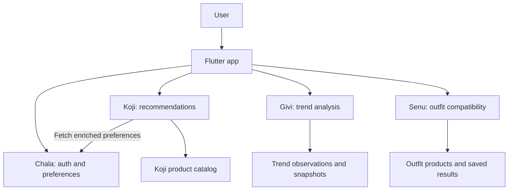

# OutfitIQ — Smart Fashion Assistant

OutfitIQ is a fashion discovery application that combines personal preferences, interaction-based learning, product recommendations, trend analysis, and outfit compatibility. A Flutter client connects to four Python FastAPI services.

Developed as a university research project, OutfitIQ brings four complementary components together in a unified application: user preference modelling, personalized recommendation, fashion trend analysis, and outfit compatibility assessment.

## Project objectives

The project investigates how explicit preferences, behavioural interactions, semantic product representations, and fashion trend data can support personalized fashion discovery.

Its objectives are to:

1. Capture and model individual fashion preferences through onboarding and user interactions.
2. Rank fashion products using a combination of preference matching, semantic similarity, and product information quality.
3. Analyse product observations to identify changing fashion trends.
4. Generate and evaluate coordinated outfits around a selected clothing item.
5. Integrate these capabilities through a common application interface and modular backend services.

## Technology stack

| Layer | Technologies |
| --- | --- |
| Application | Flutter, Dart, Provider |
| Backend APIs | Python, FastAPI, Pydantic, Uvicorn |
| Data persistence | PostgreSQL, SQLAlchemy; Alembic for trend-service migrations |
| Authentication | Google Sign-In, JWT, Flutter Secure Storage |
| Machine learning | scikit-learn, SentenceTransformers, PyTorch, FashionCLIP, Outfit Transformer, TrendNet |
| Data collection | Python-based product crawlers and collection utilities |
| Testing | Python unittest, pytest, Flutter Test |

## Features

- Google sign-in and backend JWT authentication.
- Onboarding for fashion preferences and profile management.
- Preference learning from product interactions, with ML-assisted preference expansion.
- Personalized product recommendations with weighted preferences, semantic similarity, quality checks, and diversity reranking.
- Product discovery with price, style, and search controls.
- Trend exploration using category and other attribute scores.
- Complete-the-look outfit generation around a selected product.
- Saved outfits, outfit ratings, and evaluation summaries.
- Links to products at their original retailers.

## Architecture

| Component | Directory | Default local port | Responsibility |
| --- | --- | --- | --- |
| Flutter client | `outfitiq_app/` | Flutter-selected | User interface, authentication state, and API clients |
| Chala | `auth-backend/` | 8001 | Authentication, onboarding, preferences, and interaction learning |
| Koji | `recommendation-backend/` | 8002 | Product collection and personalized recommendations |
| Givi | `trend-engine/` | 8003 | Product observations, trend computation, and trend APIs |
| Senu | `outfitcompatibility-engine/` | 8004 | Outfit generation, compatibility scoring, saved outfits, and feedback |



Each service maintains its own database configuration. Catalog synchronization utilities support product-data exchange with the authentication and outfit compatibility components.

The Flutter application consumes attribute-level trend information. The trend backend additionally provides product and observation APIs for catalog exploration and analysis.

## Main user flow

1. Sign in with Google and complete preference onboarding.
2. Browse recommendations generated from the enriched preference profile.
3. View products and record interactions that inform preference learning.
4. Explore trending fashion attributes.
5. Select a product to generate compatible outfit combinations.
6. Save outfits and submit ratings or feedback.

## Recommendation and ML components

### Personalized recommendations

The recommendation service combines three scores:

```text
final_score = 0.60 × user_match
            + 0.25 × semantic_similarity
            + 0.15 × product_quality
```

Preference weights distinguish explicit selections from inferred preferences. Candidate checks exclude unavailable and non-fashion products, and reranking encourages variety across sources and product families.

The semantic model is loaded from `ml_models/koji-fashion-sim-v1/`.

### Preference expansion

The auth service includes a logistic model and supporting feature metadata under `auth-backend/app/ml/models/`. Enriched preference responses include weighted metadata used by the recommendation service.

### Trend analysis

The trend service contains observation processing, trend-scoring logic, and TrendNet weights under `trend-engine/app/ml/`. Ingestion and trend computation jobs in `trend-engine/jobs/` prepare the snapshots served by the API.

### Outfit compatibility

The compatibility service combines outfit-generation logic with a FashionCLIP/Outfit Transformer inference path under `outfitcompatibility-engine/app/ml_v2/`. Cached product image embeddings provide the visual representations used in model-based outfit assessment. Generated outfits can be saved and rated through the application.

## Repository layout

```text
OutfitIQ-App/
├── outfitiq_app/                 # Main Flutter application
├── auth-backend/                 # Auth, preferences, and learning
├── recommendation-backend/       # Crawling and recommendation ranking
├── trend-engine/                 # Trends, ingestion, migrations, and collector
├── outfitcompatibility-engine/   # Outfit generation and compatibility
├── ml_models/                    # Recommendation model bundle
├── References/                   # Integration notes and historical handoffs
├── api-evidence/                 # Saved API specifications and test evidence
├── start_all_backends.ps1        # Existing local launch helper
├── stop_all_backends.ps1         # Existing shutdown helper
└── connect_phone.ps1             # Android USB connection helper
```

## Installation and execution

### Prerequisites

- Flutter with a Dart SDK satisfying `^3.11.5`, as declared in the app's `pubspec.yaml`.
- Python compatible with each service's dependency requirements; the trend service specifies Python `>=3.11`.
- PostgreSQL connections for the services.
- Google OAuth configuration for the intended Flutter platform and backend token verification.
- Required model bundles and populated product data.
- Android tooling and ADB if running the USB phone demo.

### 1. Prepare backend environments

In each backend directory, create a separate virtual environment and install that directory's dependencies:

```powershell
python -m venv venv
.\venv\Scripts\python.exe -m pip install -r requirements.txt
```

Keep separate environments because the services have different dependency sets.

### 2. Configure environment variables

Create service-local `.env` files with the following settings. Supply credentials through local configuration; never commit real secrets.

| Service | Required configuration | Additional settings |
| --- | --- | --- |
| Auth | `DATABASE_URL`, `GOOGLE_CLIENT_ID`, `JWT_SECRET_KEY` | `JWT_ALGORITHM` defaults to `HS256`; `JWT_ACCESS_TOKEN_EXPIRE_MINUTES` defaults to `60` |
| Recommendations | `DATABASE_URL`, `CHALA_API_URL` | For the default local setup, use `CHALA_API_URL=http://127.0.0.1:8001` |
| Trends | `DATABASE_URL`, `ADMIN_API_KEY` | See `trend-engine/.env.example` and `app/config.py` |
| Outfit compatibility | `DATABASE_URL` | See `outfitcompatibility-engine/app/s_config.py` |

Google sign-in also needs matching client/platform configuration in the Flutter application. Review `outfitiq_app/lib/services/auth_service.dart` and the relevant platform settings.

For a new, dedicated development trend database, review and apply the Alembic migrations from `trend-engine/`. The initial migration replaces the legacy schema, so preserve any existing data before applying the migration history:

```powershell
.\venv\Scripts\python.exe -m alembic upgrade head
```

### 3. Start the services

Run each command in a separate terminal from the corresponding service directory:

| Working directory | Command |
| --- | --- |
| `auth-backend/` | `.\venv\Scripts\python.exe -m uvicorn app.main:app --host 127.0.0.1 --port 8001` |
| `recommendation-backend/` | `.\venv\Scripts\python.exe -m uvicorn app.main:app --host 127.0.0.1 --port 8002` |
| `trend-engine/` | `.\venv\Scripts\python.exe -m uvicorn app.main:app --host 127.0.0.1 --port 8003` |
| `outfitcompatibility-engine/` | `.\venv\Scripts\python.exe -m uvicorn app.main:app --host 127.0.0.1 --port 8004` |

Open `/docs` on each service to inspect its generated API documentation. Trend application endpoints use the `/api/v1` prefix.

The commands above launch the services directly from this repository. If alternative ports are needed, update the backend commands, Flutter API configuration, service-to-service URLs, and ADB forwarding consistently.

### 4. Start Flutter

From `outfitiq_app/`:

```powershell
flutter pub get
flutter run -d chrome
```

The client defaults to `http://127.0.0.1`, with ports configured in `lib/core/api_config.dart`. Profile > Server Connection supports a persisted host override; this does not independently change each service's port.

For an Android phone, the included `connect_phone.ps1` helper is intended to configure ADB reverse forwarding. A LAN connection instead requires reachable backend bindings, firewall configuration, and the appropriate host override.

### 5. Prepare product data

Available synchronization and embedding utilities include:

- `auth-backend/sync_koji_products.py`
- `outfitcompatibility-engine/scripts/s_sync_koji_products.py`
- `outfitcompatibility-engine/scripts/s_generate_embeddings.py`

Configure the target databases, synchronize the required product catalogs, and generate product embeddings before demonstrating the corresponding recommendation and outfit-generation flows.

## Tests and validation

Run these commands from each listed directory after installing its development dependencies:

| Directory | Command |
| --- | --- |
| `auth-backend/` | `.\venv\Scripts\python.exe -m unittest discover -s tests -q` |
| `recommendation-backend/` | `.\venv\Scripts\python.exe -m unittest discover -s tests -q` |
| `outfitcompatibility-engine/` | `.\venv\Scripts\python.exe -m pytest tests -q` |
| `trend-engine/` | `.\venv\Scripts\python.exe -m pytest tests -q` |
| `outfitiq_app/` | `flutter test` |

The trend service provides `requirements-dev.txt`. Its API test fixtures connect to the configured PostgreSQL database and use rollback transactions; select an appropriate test database before running them.

The repository includes tests for preference metadata, recommendation weighting, product filtering, outfit generation and storage, trend processing, and Flutter response parsing. API specifications and recorded integration requests are provided in `api-evidence/` as supporting project material.

## Supporting material

- `References/`: component references and integration documentation.
- `api-evidence/`: saved OpenAPI specifications, source snapshots, and historical API results.
- `auth-backend/API_DOCUMENTATION.md`: auth-component API documentation.
- `outfitcompatibility-engine/app/ml_v2/README.md`: outfit model bundle documentation.

## Academic context

OutfitIQ combines multiple machine-learning and software-engineering approaches within an integrated fashion-assistance workflow. The repository contains the application source, backend services, model assets, and supporting integration material for the project. Detailed methodology, experimental results, and evaluation should be read alongside the accompanying academic report.
